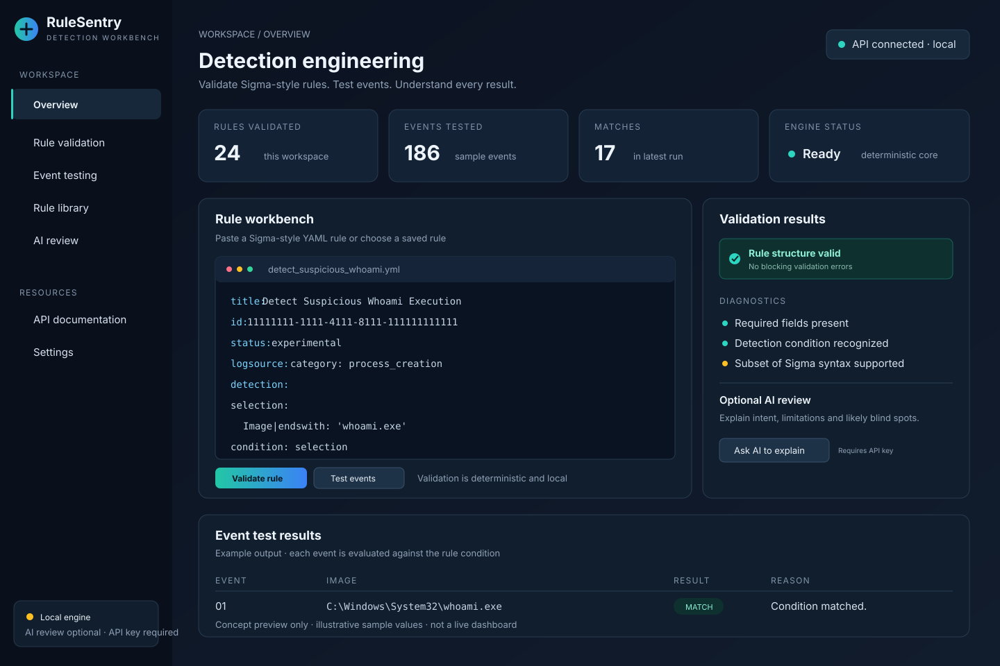

# RuleSentry AI

**AI-assisted Sigma detection engineering, with deterministic validation and transparent event tests.**

RuleSentry AI is an open-source workbench for detection engineers and security analysts. It validates Sigma-style YAML rules, tests them against sample JSON events, and can optionally request an AI-assisted explanation through OpenRouter.

> **Scope and safety:** The initial local engine supports a documented subset of Sigma syntax; it is not a complete Sigma implementation. AI output is advisory and can be wrong. Do not send secrets, customer data, or sensitive telemetry to an external AI provider.

## Features

- YAML parsing and structural rule validation.
- Local event matching for supported field comparisons and simple conditions.
- Per-event match results and explicit unsupported-syntax diagnostics.
- Interactive browser dashboard matching the supplied concept design.
- Optional OpenRouter rule explanation; the core validator works without an API key.
- FastAPI API, Docker support, tests, and contributor/security guidance.

## Quick start

Requires Python 3.11+ and Node.js 20+.

### Run the API and dashboard locally

```bash
git clone https://github.com/adhi001/RuleSentry-AI.git
cd RuleSentry-AI

python -m venv .venv
# Linux/macOS
source .venv/bin/activate
# Windows PowerShell: .venv\\Scripts\\Activate.ps1
pip install -e ".[dev]"
uvicorn rulesentry.main:app --reload
```

In a second terminal:

```bash
cd frontend
npm install
npm run dev
```

Open the Vite URL shown in the terminal (normally http://localhost:5173). The development server proxies API requests to http://127.0.0.1:8000. The API's interactive documentation remains at http://127.0.0.1:8000/docs.

### Run the combined application with Docker

```bash
docker build -t rulesentry-ai .
docker run --rm -p 8000:8000 --env-file .env rulesentry-ai
```

Then open http://localhost:8000. The container builds the frontend and serves it through FastAPI.

## Dashboard

The dashboard implements the supplied visual concept: dark navigation sidebar, workspace status cards, YAML rule workbench, validation diagnostics, optional AI explanation, and JSON event testing with per-event results.

The dashboard calls the existing API routes:

- `GET /health` — local engine connection status.
- `POST /api/v1/rules/validate` — validate the YAML rule.
- `POST /api/v1/rules/test` — evaluate JSON events against the rule.
- `POST /api/v1/rules/explain` — optional AI explanation; requires an OpenRouter API key.

Dashboard statistics are session counters based on actions performed in the open browser session. They are not persisted or presented as organization-wide telemetry. The rule library, accounts, and persistent storage are not implemented; the Rule library navigation item is marked as coming soon.

For a separately hosted frontend, set `VITE_API_BASE_URL` at build time to the API origin and configure `RULESENTRY_CORS_ORIGINS` on the API to include the frontend origin.

## API examples

### Validate a rule

`POST /api/v1/rules/validate`

```json
{
  "rule": "title: Detect whoami\nid: 11111111-1111-4111-8111-111111111111\nstatus: experimental\ndescription: Detect whoami execution\nlogsource:\n  category: process_creation\ndetection:\n  selection:\n    Image|endswith: whoami.exe\n  condition: selection\n"
}
```

### Test events

`POST /api/v1/rules/test`

```json
{
  "rule": "title: Detect whoami\nid: 11111111-1111-4111-8111-111111111111\nstatus: experimental\ndescription: Detect whoami execution\nlogsource:\n  category: process_creation\ndetection:\n  selection:\n    Image|endswith: whoami.exe\n  condition: selection\n",
  "events": [{"Image": "C:\\\\\\\\Windows\\\\\\\\System32\\\\\\\\whoami.exe"}]
}
```

Supported initial subset: exact values, lists, and `contains`, `startswith`, `endswith`, and `re` modifiers; simple `and`, `or`, `not`, parentheses; and `1 of them`, `all of them`, or wildcard selection groups. Unsupported constructs are reported as not evaluated, not silently treated as non-matches.

### Optional AI explanation

Set `OPENROUTER_API_KEY` and optionally `OPENROUTER_MODEL`, then call `POST /api/v1/rules/explain`. The rule text is sent to OpenRouter. Use sanitized, non-sensitive content only.

## Configuration

Copy `.env.example` to `.env`.

| Variable | Purpose | Default |
|---|---|---|
| `OPENROUTER_API_KEY` | Optional AI review key | unset |
| `OPENROUTER_MODEL` | OpenRouter model identifier | `openrouter/auto` |
| `OPENROUTER_BASE_URL` | OpenRouter API base URL | `https://openrouter.ai/api/v1` |
| `APP_ENV` | Environment label | `development` |
| `RULESENTRY_CORS_ORIGINS` | Comma-separated allowed browser origins for a separately hosted frontend | localhost Vite origins |

Never commit `.env`, API keys, credentials, or production logs.

## Development

```bash
pip install -e ".[dev]"
pytest
ruff check .
cd frontend
npm install
npm run build
```

## Roadmap

- Full Sigma support using pySigma and backend plugins.
- ATT&CK technique mapping and coverage views.
- Detection-quality heuristics and false-positive review workflows.
- Analyst report export.
- Persistent rule library, authentication, and team collaboration.

## Contributing

Issues and pull requests are welcome. See [CONTRIBUTING.md](CONTRIBUTING.md). Contribution enquiries: **astromediasnet16@gmail.com**.

## Security

See [SECURITY.md](SECURITY.md). Do not include secrets, customer data, or unredacted telemetry in public issues.

## License

MIT. See [LICENSE](LICENSE).

## Dashboard concept reference

The implemented frontend follows this design reference. The preview is illustrative; the live dashboard displays session results returned by the API.


